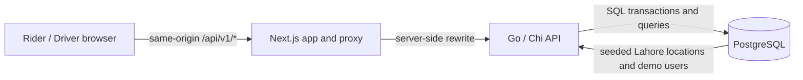
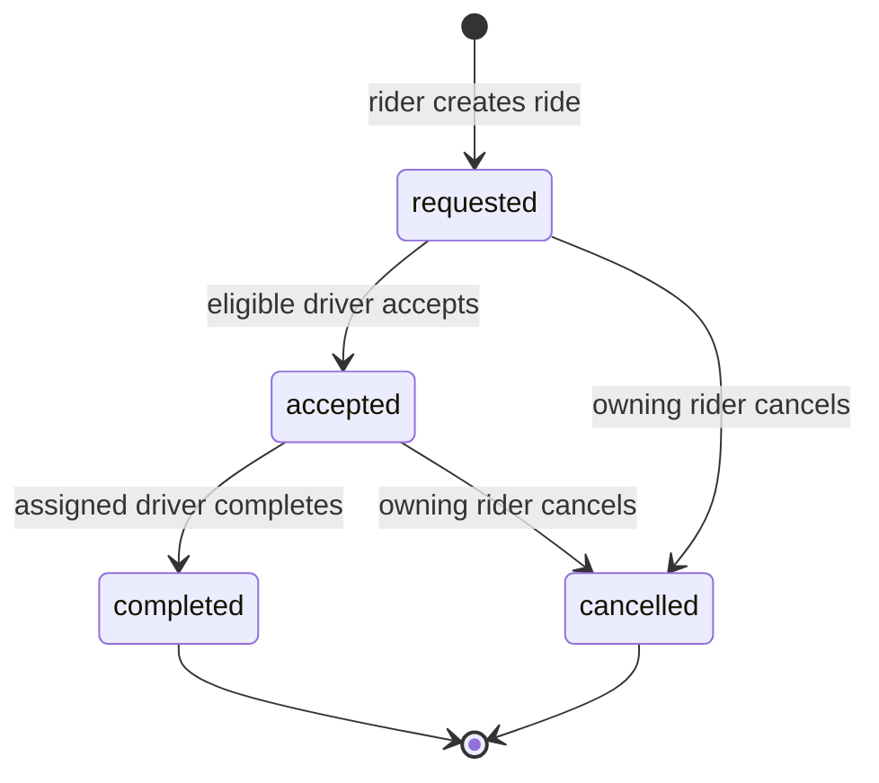

# Architecture

## Current target

The assessment is a small modular monolith. The browser uses one Next.js application. Its same-origin `/api/v1/*` requests are rewritten server-side to a single Go/Chi service. Go owns identity, validation, pricing, matching, and ride state. PostgreSQL is the sole durable source of truth. Assignment and driver availability changes commit in one database transaction.

Compose will run `web`, `api`, and `db` on a private development network. Browser code never resolves the Docker-only API hostname. No message broker or cache is in the booking path.

## Ride lifecycle

Terminal states have no outgoing transition. An accepted ride's cancellation or completion also closes its assignment and returns the driver to `available`, in the same PostgreSQL transaction. `busy` is derived from an active assignment and is never a user-selected state.

## Acceptance transaction

1. Start a transaction and lock the requested ride row.
2. Lock the acting driver row in the documented ride-then-driver order.
3. Recheck ride state, driver role/status, city, category, approximate radius, and existing active assignment.
4. Insert the unique assignment and update ride to `accepted` and driver to `busy`.
5. Commit all changes. Any failed precondition rolls the transaction back.

Unique constraints protect one assignment per ride and one active assignment per driver. A partial unique index protects one open ride per rider. These database rules work across API processes; a Go mutex does not. Cancellation and completion use the same lock order and update all related rows atomically.

## Demo boundaries

Current planned behavior uses fixed Lahore coordinates, Haversine distance multiplied by 1.3, illustrative category fares, a 20 km configurable matching radius, and a nearest-driver ETA at an illustrative 25 km/h. Active pages poll every 2–3 seconds. These choices support a deterministic demo; they do not provide routing, live GPS, dispatch guarantees, payment, or real-market fare data.

Redis/GEOSEARCH or PostGIS, live location updates, WebSockets/SSE, event brokers, service extraction, payments, and production deployment are future evolution only. They are not part of this assessment runtime.
