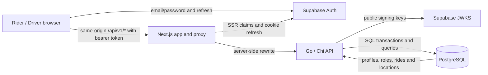
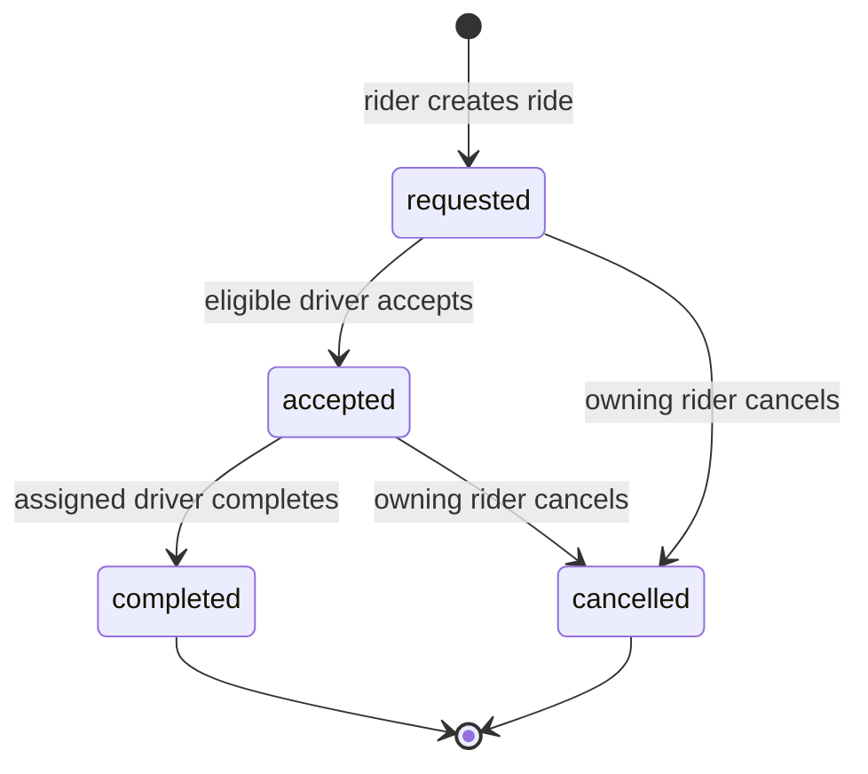

# Architecture

## Current target

The app is a small modular monolith. The browser uses one Next.js application. Its same-origin `/api/v1/*` requests are rewritten server-side to a single Go/Chi service. Supabase Auth owns credentials and browser sessions; Go validates access tokens and owns application profiles, authorization, pricing, matching, and ride state. PostgreSQL is the sole durable source of ride state. Assignment and driver availability changes commit in one database transaction.



For local development, run Next.js and Go as separate host processes. PostgreSQL is an external Supabase database; in the configured development checkout, the schema was migrated and seeded against that project. No local database or Docker container is part of this workflow. The web rewrite sends browser requests through the Next.js server to Go, and the database connection string remains server-side. No message broker or cache is in the booking path.

Application tables are created in the private `ride_hailing` schema, omitted from this repository's Supabase Data API schema list. RLS is enabled and forced on each table without browser policies or grants. On 2026-11-02, a request to the configured project's Data API for `ride_hailing` returned `PGRST106`, confirming the schema is not exposed; role `USAGE` grants were also absent. The trusted Go service uses qualified table names and the server-side PostgreSQL connection. The profile seed maps existing Supabase Auth users to app roles.

The browser uses `@supabase/ssr` for cookie-backed session persistence and `src/proxy.ts` for token refresh. Browser API requests carry an explicit bearer access token; the Go API verifies the ES256/RS256 signature using the project's public JWKS and validates issuer, audience, expiry, and UUID subject. It maps that subject to `ride_hailing.users.supabase_auth_id` and reads the app role from PostgreSQL. It never trusts user metadata for authorization. Mutating requests also require the configured Origin. Sign-out clears the browser session, while a previously issued access token may remain valid until expiry.

## Why this stack

- **Next.js and TypeScript** provide the browser application, server-side rewrite, and Supabase cookie refresh in one frontend runtime. That keeps browser requests same-origin while leaving business rules in Go. The cost is operating a Node process alongside the API.
- **Go and Chi** keep the API small, explicit, and easy to run as a separate process. `pgx` exposes PostgreSQL transactions and row locks directly. NestJS would bring a larger TypeScript server framework and reuse more frontend language; FastAPI would make Python the business runtime. Either could implement the same database rules, but neither makes concurrent assignment safe by itself.
- **PostgreSQL** is the durable authority for ride status, idempotency, assignment, and driver occupancy. Row locks and unique constraints protect invariants across API instances. The trade-off is that race behavior must be verified against PostgreSQL, which requires a configured database.
- **One repository and a modular monolith** keep the API, UI, migration, contract, and checks reviewable together. One backend avoids duplicating fare and authorization logic. The trade-off is that the repository contains both Node and Go toolchains.

No framework or process mutex guarantees race safety. The API transaction and PostgreSQL constraints do.

## Ride lifecycle



Terminal states have no outgoing transition. An accepted ride's cancellation or completion also closes its assignment and returns the driver to `available`, in the same PostgreSQL transaction. `busy` is derived from an active assignment and is never a user-selected state.

## Acceptance transaction

1. Start a transaction and lock the requested ride row.
2. Lock the acting driver row in the documented ride-then-driver order.
3. Recheck ride state, driver role/status, city, category, approximate radius, and existing active assignment.
4. Insert the unique assignment and update ride to `accepted` and driver to `busy`.
5. Commit all changes. Any failed precondition rolls the transaction back.

Unique constraints protect one assignment per ride and one active assignment per driver. A partial unique index protects one open ride per rider. Lifecycle triggers reject invalid transitions and edits to the persisted quote; deferred consistency triggers require accepted/completed rides, assignments, and driver availability to agree at commit. These database rules work across API processes; a Go mutex does not. Cancellation and completion use the same lock order and update all related rows atomically.

## Retries and duplicate requests

The rider browser creates one `Idempotency-Key` per booking intent and saves the key and normalized form in `sessionStorage`, scoped to the signed-in application user. It reuses that key when the network result is uncertain. Go fingerprints the normalized pickup, destination, and category, then stores the rider/key/hash/ride association in the same transaction as the ride. A matching replay returns the stored ride; a different payload under the same key is `409`. The unique rider/key constraint and one-open-ride index also reject retries sent to another API process or after a browser reload.

When a create response is lost, the UI first checks the rider's current ride. If the ride is not visible yet, it keeps the original key and lets the rider retry safely. It suppresses duplicate submission while pending, displays `401` sign-in errors and `409` conflicts, and stops active polling after a terminal state. Polling is the only current status update mechanism; there is no automatic exponential retry loop.

## Growth path (future)

For more cities and traffic, keep Go stateless and add API replicas behind a load balancer. Keep ride ownership and assignment city-scoped in SQL, review query plans and indexes, use managed PostgreSQL with connection pooling, and measure pool saturation, lock waits, query latency, and request errors before changing topology. PostGIS can replace approximate radius calculations when real location data exists. Redis can hold expiring, high-frequency driver presence and support GEOSEARCH; PostgreSQL remains authoritative for ride assignment and driver occupancy. SSE or WebSockets can later replace polling for active ride updates and GPS transport.

Introduce **Redis** when driver presence and geographic lookup volume make database polling costly or stale, with expiry and reconciliation rules. Introduce **Kafka/Redpanda or NATS JetStream** when multiple independently scaled consumers need durable ride events, replay, or backpressure. Write an outbox row in the same PostgreSQL transaction as the ride change, publish asynchronously, and make consumers idempotent because delivery is at least once. Extract a service only when separate team ownership, scaling needs, or reliability isolation outweigh the cost of network contracts and distributed operations.

## Deployment and operations (future)

Build immutable API and web artifacts in CI, run tests and migration compatibility checks before release, and use managed PostgreSQL with backups, restore drills, HTTPS, and managed secrets. Apply additive migrations before code that requires them, deploy compatible app versions, then remove old columns in a later release. Readiness should check the dependencies needed to serve requests; liveness should only indicate that a process is alive. Preserve request IDs, structured logs, and add traces and metrics for latency, authorization failures, database pool use, lock waits, ride transitions, and migration state. Roll back application artifacts to the last compatible version; use a forward fix for a migration that has already changed durable data.

## Highest-priority work before a real service

1. Replace static driver points and approximate matching with fresh, expiring location updates and a dispatch process that handles driver response and offer expiry.
2. Complete production identity and security operations: controlled onboarding, account recovery, key rotation, access revocation policy, abuse limits, and a reviewed data-access model.
3. Add operational resilience and visibility: managed deployment, alerts, backups and restore practice, dependency and lock metrics, and safe migration/rollback procedures.

Payment capture/refunds and market-calibrated pricing follow after those foundations. They are not current app capabilities.

```mermaid
sequenceDiagram
    participant D as Driver browser
    participant A as Go API
    participant P as PostgreSQL
    D->>A: POST /rides/{id}/accept with bearer token
    A->>A: Verify token and load driver profile
    A->>P: Begin transaction; lock ride row
    A->>P: Lock driver row and recheck eligibility
    A->>P: Insert assignment; set ride accepted and driver busy
    P-->>A: Commit
    A-->>D: Current ride and assignment
```

## Demo boundaries

Riders can use seeded Lahore stops or place custom pins within the configured service bounds. The API calculates approximate Haversine distance using a configurable road factor and a manually maintained fare card with petrol price/effective date, vehicle efficiency, base fare, and operating cost. Each ride stores the fare breakdown as an immutable snapshot. Matching still uses static driver coordinates, a configurable 20 km radius, and a nearest-driver ETA at an illustrative 25 km/h. Active pages poll every 2–3 seconds. These choices support a deterministic demo; they do not provide road routing, live GPS, dispatch guarantees, payment, or automatic fuel-price updates.

Redis/GEOSEARCH or PostGIS, live location updates, WebSockets/SSE, event brokers, service extraction, payments, and production deployment are future evolution only. They are not part of this assessment runtime.
